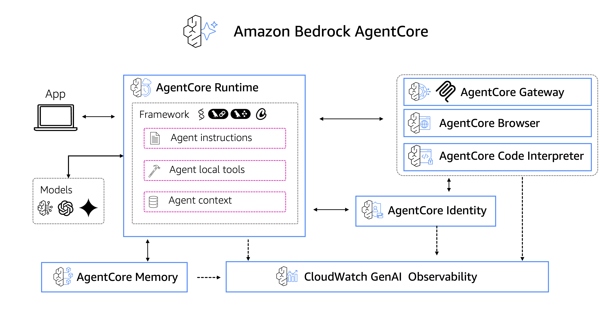
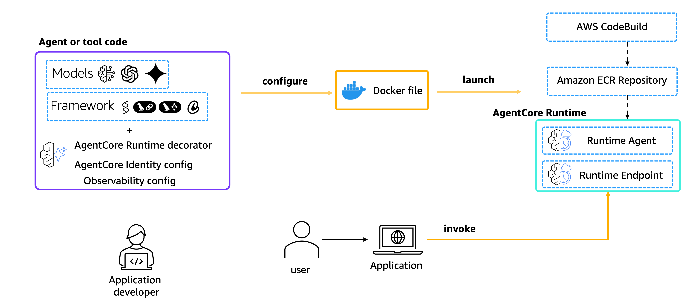
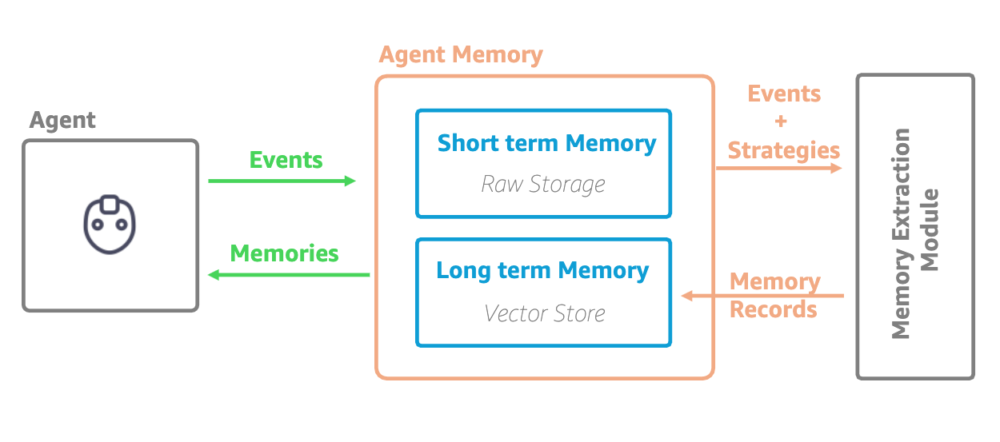

# Starting with Amazon Bedrock AgentCore

   
  
<em>Bring AI agents into production in minutes with Amazon Bedrock AgentCore</em>

This repository contains hands-on labs demonstrating the capabilities of [Amazon Bedrock AgentCore](https://docs.aws.amazon.com/bedrock-agentcore/latest/devguide/what-is-bedrock-agentcore.html), an agentic platform to build, deploy and operate agents securely at scale - using any framework and model.

## What is Amazon Bedrock AgentCore?

Amazon Bedrock AgentCore enables developers to accelerate AI agents into production with enterprise-grade scale, reliability, and security. AgentCore provides composable services that work with popular open-source frameworks and any model, eliminating the choice between open-source flexibility and enterprise requirements.

### AgentCore Services Overview

| Service | Purpose | Key Features |
|---------|---------|--------------|
| **[AgentCore Runtime](https://docs.aws.amazon.com/bedrock-agentcore/latest/devguide/runtime.html)⭐** | Serverless execution | Auto-scaling, session management, container orchestration |
| **[AgentCore Identity](https://docs.aws.amazon.com/bedrock-agentcore/latest/devguide/identity.html)** | Credential management | API keys, OAuth tokens, secure vault |
| **[AgentCore Memory](https://docs.aws.amazon.com/bedrock-agentcore/latest/devguide/memory.html)⭐** | State persistence | Short-term memory, long-term storage |
| **[AgentCore Gateway](https://docs.aws.amazon.com/bedrock-agentcore/latest/devguide/gateway.html)** | Connects agent to tools and data | Tool discovery, service integration |
| **[AgentCore Code Interpreter](https://docs.aws.amazon.com/bedrock-agentcore/latest/devguide/code-interpreter-tool.html)** | Code execution | Secure sandbox, data analysis |
| **[AgentCore Browser](https://docs.aws.amazon.com/bedrock-agentcore/latest/devguide/browser-tool.html)** | Web interaction | Cloud browser, auto-scaling |
| **[AgentCore Observability](https://docs.aws.amazon.com/bedrock-agentcore/latest/devguide/observability.html)** | Monitoring | Tracing, dashboards, debugging |
| **[AgentCore Policy](https://docs.aws.amazon.com/bedrock-agentcore/latest/devguide/policy.html)** | Security boundaries | Deterministic control, Cedar policies, natural language authoring |
| **[AgentCore Evaluations](https://docs.aws.amazon.com/bedrock-agentcore/latest/devguide/evaluations.html)** | Performance assessment | Automated testing, LLM-as-a-Judge, quality metrics |

## Prerequisites

Before starting any lab, ensure you have:
- [AWS Account](https://aws.amazon.com/account/?trk=87c4c426-cddf-4799-a299-273337552ad8&sc_channel=el) with [appropriate permissions](https://docs.aws.amazon.com/bedrock-agentcore/latest/devguide/runtime-permissions.html)
- Python 3.10+ installed
- [AWS CLI configured](https://docs.aws.amazon.com/cli/latest/userguide/getting-started-install.html)
- [AgentCore CLI](https://github.com/aws/agentcore-cli) (`npm install -g @aws/agentcore`, requires Node.js 20.12+)
- [uv](https://docs.astral.sh/uv/getting-started/installation/) (the AgentCore CLI uses it to run and package Python agents)
- Basic understanding of [AI agents](https://aws.amazon.com/what-is/ai-agents/?trk=87c4c426-cddf-4799-a299-273337552ad8&sc_channel=el) and [AWS services](https://aws.amazon.com/what-is-aws/?trk=87c4c426-cddf-4799-a299-273337552ad8&sc_channel=el)

> **Note:** These labs use the [AgentCore CLI](https://github.com/aws/agentcore-cli). The Python Bedrock AgentCore Starter Toolkit is no longer supported; if you have it installed, uninstall it (`pip uninstall bedrock-agentcore-starter-toolkit`) because both tools provide an `agentcore` command.

## Overview

| 📓 Services | 🎯 Focus & Key Learning | ⏱️ Time | 📊 Level |
|-------------|------------------------|----------|----------|
| **01 - [Amazon Bedrock AgentCore Runtime](./01-agentcore-runtime/)** | Serverless AI agent deployment with auto-scaling, session management, and built-in security | 10 min |  | 
| **02 - [Amazon Bedrock AgentCore Memory](./02-agentcore-memory/)** | Context-aware memory for conversation context and cross-session knowledge retention | 10 min |  | 
---

## Detailed Lab Descriptions

| 📓 Services | 🎯 Focus & Key Learning | 🖼️ Diagram |
|-------------|------------------------|-------------|
| **Amazon Bedrock AgentCore Runtime** | **Focus**: [Serverless AI Agent Deployment](https://docs.aws.amazon.com/bedrock-agentcore/latest/devguide/runtime-how-it-works.html)  Deploy production-ready AI agents with a few AgentCore CLI commands using AgentCore Runtime. This lab demonstrates: • Serverless agent deployment with auto-scaling • Session management and isolation • Built-in security and authentication • Integration with Strands Agents framework  **Key Learning**: Transform prototype agents into production-ready services in minutes, not weeks. |  |
| **Amazon Bedrock AgentCore Memory** | **Focus**: [Intelligent Memory Capabilities](https://docs.aws.amazon.com/bedrock-agentcore/latest/devguide/memory.html)  Add context-aware memory to AI agents using AgentCore Memory. This lab covers: • Short-term memory for conversation context • Long-term memory for user preferences • Cross-session knowledge retention • Personalized agent experiences  **Key Learning**: Build agents that remember and learn from interactions to provide more intelligent responses. |  |

## Getting Started

Each lab includes:
- **Prerequisites**: Required setup and dependencies
- **Step-by-step deployment**: Automated infrastructure setup
- **Code explanations**: Detailed implementation walkthrough
- **Cleanup instructions**: Resource removal

**Ready to deploy production AI agents?** Start with [01-agentcore-runtime](./01-agentcore-runtime/) to learn the fundamentals of AgentCore Runtime.

## Resources

### Documentation
- [What is Amazon Bedrock AgentCore?](https://docs.aws.amazon.com/bedrock-agentcore/latest/devguide/what-is-bedrock-agentcore.html)
- [AgentCore Runtime How It Works](https://docs.aws.amazon.com/bedrock-agentcore/latest/devguide/runtime-how-it-works.html)
- [AgentCore Memory Guide](https://docs.aws.amazon.com/bedrock-agentcore/latest/devguide/memory.html)
- [AgentCore Gateway Documentation](https://docs.aws.amazon.com/bedrock-agentcore/latest/devguide/gateway.html)
- [Invoke an AgentCore Runtime agent](https://docs.aws.amazon.com/bedrock-agentcore/latest/devguide/runtime-invoke-agent.html)
- [AgentCore CLI](https://github.com/aws/agentcore-cli)

### Code Examples
- [AWS Labs AgentCore Samples](https://github.com/awslabs/amazon-bedrock-agentcore-samples/)

## Security

See [CONTRIBUTING](CONTRIBUTING.md) for more information.

## License

This library is licensed under the MIT-0 License. See the [LICENSE](LICENSE) file.

---

